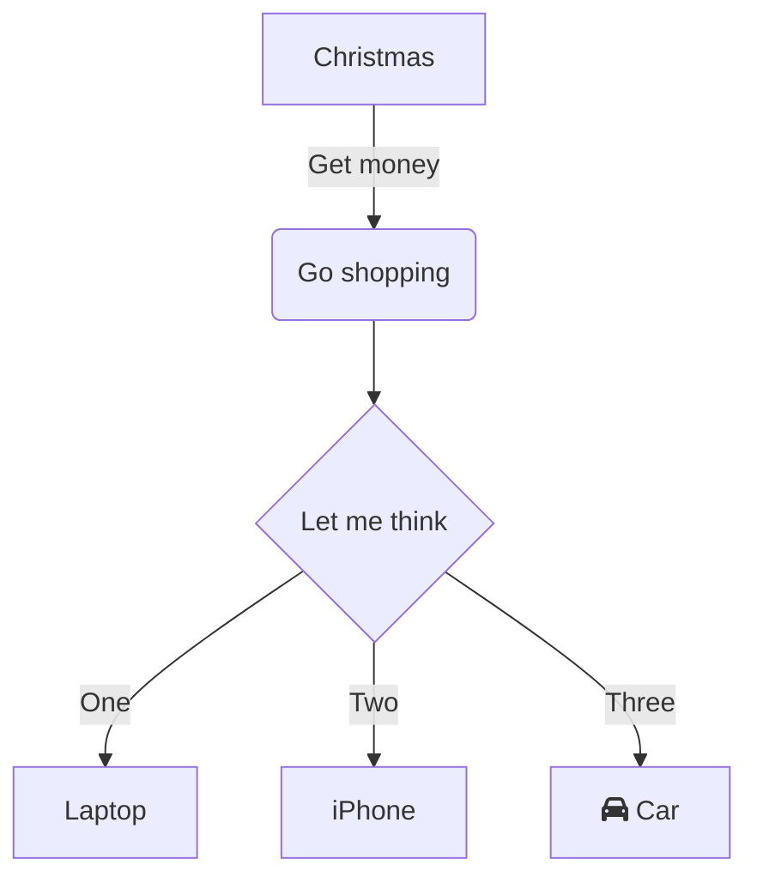

# Meeting notes

* 📅 15 January 2021, via Nextcloud Talk
* 👥 Julius, Vanessa, Jan, …

## Tasks ✅

* [ ] Finish marketing campaign
* [ ] To do 2
* [ ] …

## Agenda 📑

* What we __want__ to change
* …

## Recap from last meeting 🔁

* …

## Discussion 💬

* Vanessa **suggested** …
* *Julius* brought ~~up~~ …

- [ ] Cos ==podswietlam==
- [ ] Inne todo

```
Code block here
what is there?
```

<details>
<summary>Details</summary>
Not sure regarding this

</details>
::: info
Careful!

:::



| header    | tytul | inny |
|-----------|-------|------|
| Cos pisze | 1     | 11   |
| Inne dane | 2     | 21   |

To jest tekst z komentarzem[^comment-1], ac jak?

Tertaz a footnote[^1], moze cos ciekawego?😩 


[http://localhost:8080/f/210](http://localhost:8080/f/210 (preview))

[^comment-1]:
    - @[someone](mention://user/someone) *(2026-10-17T23:04:44.793Z)*
      Co to jest?

[^1]: Tutaj jest tresc footnote